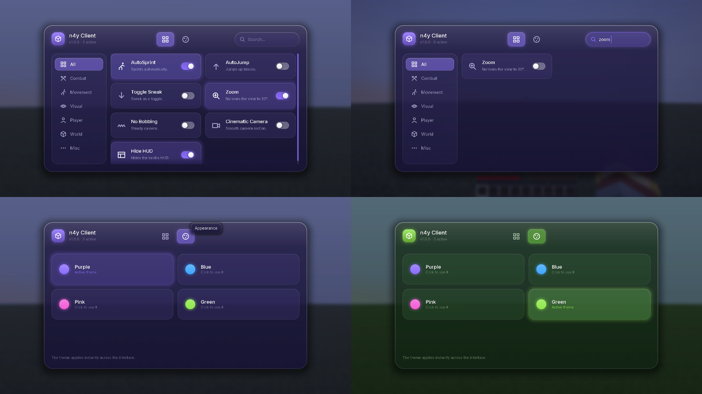
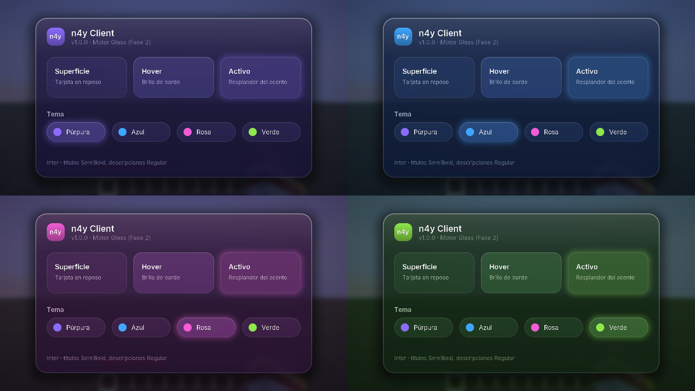

# n4y Client

Cliente personal de Minecraft **1.21.11** para **Fabric**, con identidad visual *Liquid Glass*.
Pensado para Singleplayer y mundos privados. Desarrollador: **4xyns**.

## Compilar

Requisitos: JDK 25 para ejecutar Gradle/Loom (el mod se compila con target Java 21, que es lo que usa Minecraft 1.21.11).

```bash
./gradlew build       # jar en build/libs/n4y-client-1.0.0.jar
./gradlew test        # tests unitarios
./gradlew runClient   # abre Minecraft de desarrollo con el mod
```

Instalar: copia `build/libs/n4y-client-1.0.0.jar` y Fabric API `0.141.6+1.21.11` en `.minecraft/mods`, con Fabric Loader `>=0.20.1`.

## Estado por fases

| Fase | Contenido | Estado |
|---|---|---|
| 1 | Fundación Fabric: entrypoint, EventBus, keybinds, rutas de config | ✅ |
| 2 | Motor gráfico Glass: formas redondeadas AA, sombras, brillos, 4 temas, animaciones, Inter | ✅ |
| 3 | Interfaz principal: cabecera, pestañas, buscador, categorías, cuadrícula con scroll | ✅ |
| 4 | Sistema de módulos: base (`Module`, `ModuleManager`) ✅ · keybinds por módulo ⏳ |
| 5 | Configuraciones y perfiles | — |
| 6 | Módulos individuales | — |
| 7 | Herramientas premium | — |
| 8 | Creator Edition | — |
| 9 | Optimización y pruebas | — |

## Estructura

```
src/main/java/com/n4y/client/
├── N4y.java              identidad (ids, versión, logger)
├── N4yClient.java        entrypoint Fabric → EventBus
└── core/
    ├── event/            EventBus sin reflexión + eventos
    ├── keybind/          keybinds globales (categoría "n4y Client")
    └── io/               rutas en .minecraft/config/n4y/
gui/
├── icon/                 iconos de línea vectoriales rasterizados al vuelo
├── widget/               tarjetas, interruptores, pestañas, buscador, barra lateral
├── anim/                 Animation + Easing (basadas en tiempo, independientes de FPS)
├── render/               GlassRenderer, ShapeTextures (máscaras AA generadas), N4yText (Inter)
├── theme/                Theme, Themes (Púrpura/Azul/Rosa/Verde), ThemeEngine (transición animada)
└── screen/               N4yMainScreen (interfaz principal)
module/                   Module, ModuleCategory, ModuleManager + módulos en impl/
src/gametest/             pruebas dentro del juego (Fabric Client GameTest)
```

## Pruebas dentro del juego

```bash
xvfb-run ./gradlew runClientGameTest   # o sin xvfb en un escritorio
```

Crea un mundo Singleplayer, abre la interfaz y guarda capturas en `build/run/clientGameTest/screenshots/`.



<details>
<summary>Motor Glass en los 4 temas (Fase 2)</summary>



</details>

## Módulos incluidos

Todos usan API pública de Minecraft, sin mixins, y restauran tus ajustes al desactivarse.

| Módulo | Categoría | Qué hace |
|---|---|---|
| AutoSprint | Movimiento | Corre solo al avanzar |
| AutoJump | Movimiento | Activa el salto automático de vanilla |
| Agacharse fijo | Jugador | Agacharse pasa a ser un interruptor |
| Zoom | Visual | Baja el FOV a 30° |
| Sin balanceo | Visual | Quita el balanceo de cámara al andar |
| Cámara cine | Visual | Cámara suave de vanilla para grabar |
| Ocultar HUD | Visual | Oculta la interfaz del juego |

Combate, Mundo y Varios están vacías a propósito: sus módulos llegan en la Fase 6.
