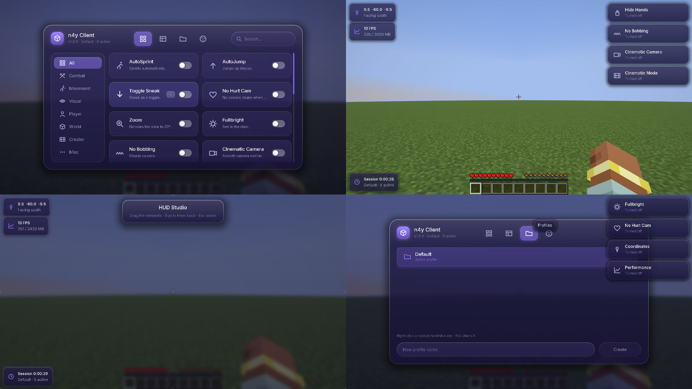
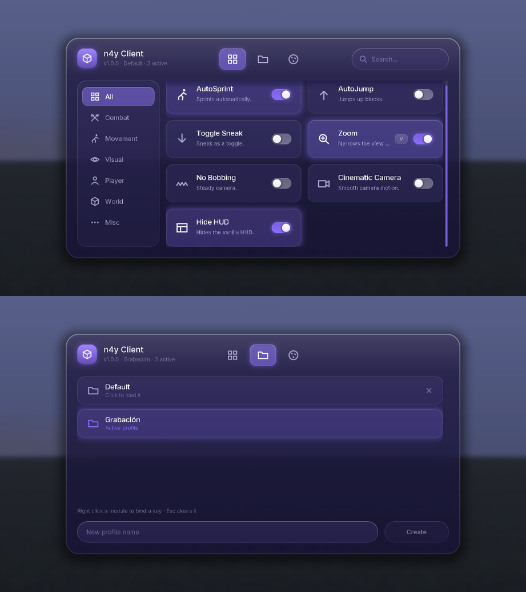

# n4y Client

Cliente personal de Minecraft **1.21.11** para **Fabric**, con identidad visual *Liquid Glass*.
Pensado para Singleplayer y mundos privados. Desarrollador: **4xyns**.

## Compilar

Requisitos: JDK 25 para ejecutar Gradle/Loom (el mod se compila con target Java 21, que es lo que usa Minecraft 1.21.11).

```bash
./gradlew build       # jar en build/libs/n4y-client-1.0.0.jar
./gradlew test        # tests unitarios
./gradlew runClient   # abre Minecraft de desarrollo con el mod
```

Instalar: copia `build/libs/n4y-client-1.0.0.jar` y Fabric API `0.141.6+1.21.11` en `.minecraft/mods`, con Fabric Loader `>=0.20.1`.

## Estado por fases

| Fase | Contenido | Estado |
|---|---|---|
| 1 | Fundación Fabric: entrypoint, EventBus, keybinds, rutas de config | ✅ |
| 2 | Motor gráfico Glass: formas redondeadas AA, sombras, brillos, 4 temas, animaciones, Inter | ✅ |
| 3 | Interfaz principal: cabecera, pestañas, buscador, categorías, cuadrícula con scroll | ✅ |
| 4 | Sistema de módulos: `Module`, `ModuleManager`, keybinds por módulo | ✅ |
| 5 | Configuración y perfiles: guardado en disco, perfiles, Keybind Manager | ✅ |
| 6 | Módulos individuales: mixins, mundo, visuales, combate | ✅ |
| 7 | Herramientas premium: HUD Studio, monitor, estadísticas, notificaciones, búsqueda rápida | ✅ |
| 8 | Creator Edition: modo cine, captura limpia, ocultar manos, mediodía fijo | ✅ |
| 9 | Optimización y pruebas: menos llamadas de dibujo, cachés, 41 tests + prueba en el juego | ✅ |

## Estructura

```
src/main/java/com/n4y/client/
├── N4y.java              identidad (ids, versión, logger)
├── N4yClient.java        entrypoint Fabric → EventBus
└── core/
    ├── event/            EventBus sin reflexión + eventos
    ├── keybind/          keybinds globales (categoría "n4y Client")
    └── io/               rutas en .minecraft/config/n4y/
gui/
├── hud/                  HudManager, HudModule, anclajes, notificaciones
├── icon/                 iconos de línea vectoriales rasterizados al vuelo
├── widget/               tarjetas, interruptores, pestañas, buscador, barra lateral
├── anim/                 Animation + Easing (basadas en tiempo, independientes de FPS)
├── render/               GlassRenderer, ShapeTextures (máscaras AA generadas), N4yText (Inter)
├── theme/                Theme, Themes (Púrpura/Azul/Rosa/Verde), ThemeEngine (transición animada)
└── screen/               N4yMainScreen (interfaz principal)
module/                   Module, ModuleCategory, ModuleManager + módulos en impl/
config/                   ConfigManager, Profile, ClientPrefs, ModuleState
core/keybind/             KeybindManager (teclas propias, sin mixins)
mixin/                    4 mixins: brillo, sacudida, manos y llamas
src/gametest/             pruebas dentro del juego (Fabric Client GameTest)
```

## Pruebas dentro del juego

```bash
xvfb-run ./gradlew runClientGameTest   # o sin xvfb en un escritorio
```

Crea un mundo Singleplayer y recorre el cliente entero con ratón y teclado reales: pestañas,
categorías, buscador, interruptores, teclas, perfiles, HUD Studio y temas, comprobando que los
módulos cambian el juego de verdad y lo dejan como estaba. Las capturas quedan en
`build/run/clientGameTest/screenshots/`.



<details>
<summary>Más capturas</summary>


</details>

## Configuración y perfiles

Todo se guarda solo en `.minecraft/config/n4y/`:

```
config/n4y/
├── client.json              qué perfil se carga al arrancar
└── profiles/
    ├── default.json         tema + módulos activos + teclas
    └── grabacion.json
```

Un perfil guarda el tema y el estado de cada módulo con su tecla, así que cambiar de perfil
cambia el cliente entero de golpe. Se escribe como mucho una vez por segundo y en un hilo
aparte, así que activar un módulo nunca frena el juego.

Teclas: clic derecho en un módulo, pulsa la tecla que quieras, y Esc la quita. Las teclas viven
en el perfil, no en las opciones de Minecraft, así que viajan contigo al cambiar de perfil.



## Módulos

18 módulos repartidos por categorías. Todos guardan tus ajustes y los devuelven al apagarse.

| Módulo | Categoría | Qué hace |
|---|---|---|
| AutoSprint | Movimiento | Corre solo al avanzar |
| AutoJump | Movimiento | Activa el salto automático de vanilla |
| Agacharse fijo | Jugador | Agacharse pasa a ser un interruptor |
| Sin sacudida | Jugador | La cámara no tiembla al recibir daño |
| Zoom | Visual | Baja el FOV a 30° |
| Luz total | Visual | Ve en cuevas sin antorchas |
| Sin balanceo | Visual | Quita el balanceo al andar |
| Cámara cine | Visual | Cámara suave de vanilla |
| Sin llamas | Visual | El fuego no te tapa la pantalla |
| Ocultar HUD | Visual | Oculta la interfaz del juego |
| Mediodía fijo | Mundo | Para el tiempo al mediodía (singleplayer) |
| Cielo despejado | Mundo | Quita la lluvia y la detiene (singleplayer) |
| Modo cine | Creador | Un interruptor que deja todo listo para grabar |
| Captura limpia | Creador | Foto sin HUD ni manos, y vuelve solo |
| Ocultar manos | Creador | Quita las manos de la vista |
| Marcador de golpe | Combate | Señal en la mira al acertar |
| Coordenadas | Varios | Tu posición y hacia dónde miras |
| Rendimiento | Varios | FPS y memoria en uso |
| Estadísticas | Varios | Tiempo de sesión y perfil activo |

Los que no se pueden hacer con API pública usan mixins mínimos: solo el brillo (Luz total),
la sacudida de cámara, el dibujado de las manos y las llamas en pantalla.

## HUD y herramientas de creador

Los elementos en pantalla (coordenadas, rendimiento, estadísticas, marcador) se colocan desde
el **HUD Studio**: arrastras cada uno donde quieras, se ancla a la esquina más cercana y la
posición se guarda en el perfil. Así se mantiene igual aunque cambies de resolución. La tecla
R los devuelve a su sitio y Esc guarda.

Las **notificaciones** avisan en una esquina de lo que activas y del perfil que cargas, con el
mismo estilo Glass. La **búsqueda rápida** es escribir directamente en la pestaña de módulos,
sin pulsar el buscador.

Para grabar: **Modo cine** enciende de golpe Ocultar HUD, Ocultar manos, Sin balanceo y
Cámara cine, y al apagarlo deja cada uno como estaba. **Captura limpia**, con una tecla
asignada, hace la foto sin interfaz ni manos y lo restaura todo solo.
